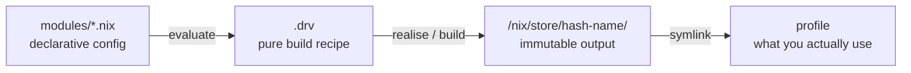
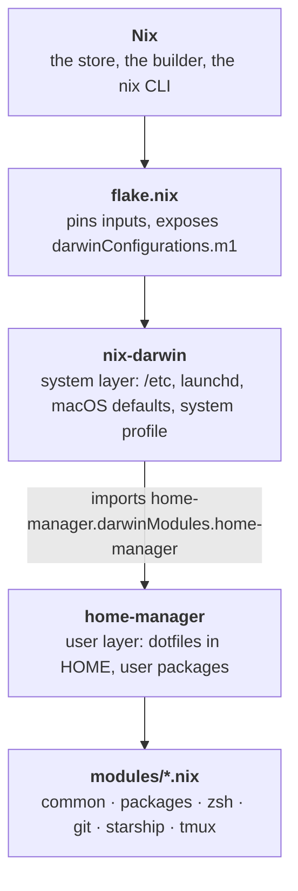
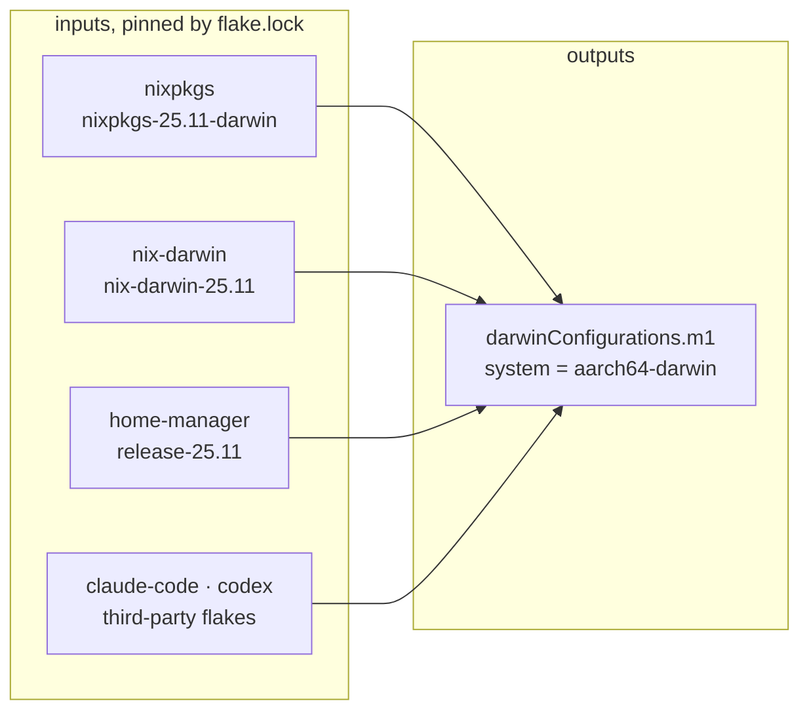
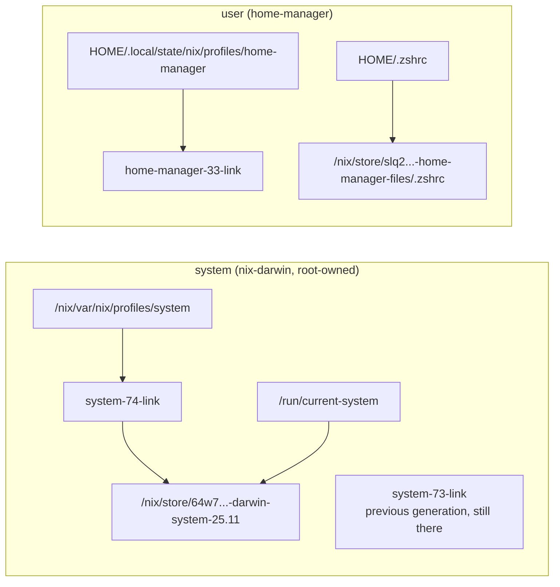

# Nix Primer

A short intro to Nix.

## Why it exists

Conventional package managers mutate global state. `brew upgrade` overwrites
what was there, so the machine you end up with depends on the order you
installed things, which versions were current that week, and whatever you
hand-edited into a dotfile two years ago. The configuration *is* the machine's
history, which means you can't reproduce it and you can't undo it.

Nix refuses to mutate anything. You declare the end state you want in the
files under `modules/`, and Nix builds exactly that into fresh, immutable
directories. What that buys:

- **Reproducible.** `flake.lock` pins every dependency to an exact revision, so
  the same repo yields the same machine today, next year, or on a new laptop.
- **Atomic.** A switch either fully succeeds or leaves you precisely where you
  were. No half-applied upgrade to untangle.
- **Reversible.** Old versions aren't overwritten, so rolling back is a symlink
  move. One command, seconds, no reinstalling.
- **No drift.** This repo is the single source of truth. Nothing can be quietly
  hand-edited, because the dotfiles in `$HOME` are read-only symlinks generated
  from these files.
- **Disposable machines.** Wiping the Mac and getting your exact shell, tools
  and prompt back is two commands.

---

## 1. The one idea

Nix is a **pure function from configuration to a directory tree**.

- **Function.** It takes an input (Nix expressions: your `modules/*.nix` plus
  the exact nixpkgs that `flake.lock` pins) and returns an output (a
  directory). You don't give Nix a sequence of steps to run, you give it a
  value to compute. Nothing is "performed on" your machine; something is built,
  then pointed at.
- **Pure.** In the mathematical sense: the same input always yields the same
  output, and nothing outside that input can influence the result. This is
  enforced, not just intended. Builds run in a sandbox with no network, no
  `/usr/local`, no `$HOME`, and a scrubbed environment, so a build *cannot*
  quietly depend on something you forgot to declare. (Source downloads are the
  one exception, and they have to state the hash of what they will fetch up
  front.) Compare `brew install`, whose result depends on what is already
  installed, which Xcode you have, and what the upstream URL happened to serve
  that morning.
- **Directory tree.** The output is not "your system, modified". It is a new,
  self-contained directory holding just that one package's files. Your real
  system is then assembled out of thousands of such directories.

Every build output lands in `/nix/store/<hash>-<name>/`, where the hash covers
*every* input: sources, compiler, flags, and the full transitive dependency
graph. Same inputs → same hash → same path → nothing to rebuild. Different
inputs → different path, so two versions of a package coexist without conflict.

So "installing" means building a store path and pointing a symlink at it, and
"upgrading" means building a *new* store path and moving the symlink. Every
benefit in *Why it exists* falls out of that one mechanism, including the ever
growing store, since the paths you upgraded away from are still sitting there. s



Three terms you'll hit in error messages:

| Term | Meaning |
| --- | --- |
| **derivation** (`.drv`) | The build recipe, produced by *evaluating* your Nix code. Evaluation is separate from building, so most errors are eval errors. |
| **realise** / **build** | Run the recipe, produce a store path. |
| **substituter** | A binary cache (`cache.nixos.org`). Since the hash is deterministic, Nix asks the cache "got this path?" first. Most "builds" are downloads; a real compile means you changed something nobody has built. |

---

## 2. The layers in this repo

These stack up, and it's easy to forget which one owns what.



| Layer | Owns | Needs sudo |
| --- | --- | --- |
| Nix | `/nix/store`, the daemon, garbage collection | daemon already runs as root |
| nix-darwin | system generation, `/etc/*`, launchd agents, `defaults write`, `/run/current-system` | **yes** |
| home-manager | `$HOME` dotfiles, your user package profile | no (but it's run by darwin-rebuild here) |

**Why both?** nix-darwin can't manage your home directory declaratively and
home-manager can't touch system state. This repo imports home-manager *as a
nix-darwin module* (`flake.nix`), so one `darwin-rebuild switch` does both and
there is no separate `home-manager` command on this machine.

---

## 3. The module system

Every file in `modules/` is a **function**, not a config file. The module
system calls it and merges whatever attribute set it returns. Exactly three
top-level keys in that set are reserved, and here is what each one is for:

```nix
{ config, pkgs, lib, ... }:        # ARGUMENTS, injected by the module system
{
  # 1. imports: other modules to load and merge into this configuration
  imports = [
    ./packages.nix
    ./zsh.nix
  ];

  # 2. options: new settings this module *declares*, for others to set
  options = {
    my.laptop.lowPower = lib.mkEnableOption "battery saving tweaks";
  };

  # 3. config: values this module *sets*
  config = {
    programs.tmux.enable = true;
    home.packages = [ pkgs.htop ];
  };
}
```

| Key | The question it answers | Where it shows up here |
| --- | --- | --- |
| `imports` | What other modules belong to this configuration? | `modules/common.nix` (the five topic modules) and `flake.nix` (the home-manager darwin module) |
| `options` | What new settings do I want to invent? | Nowhere. You only *consume* options that nixpkgs, nix-darwin and home-manager already declare. Writing your own matters once you build reusable modules. |
| `config` | What am I actually setting? | Everything else in `modules/` |

Any top-level attribute that is **not** one of those three is treated as though
it were inside `config`. That shorthand is what every file in this repo uses:

```nix
{ config, pkgs, ... }:
{
  programs.tmux.enable = true;   # no `config = { ... }` wrapper needed, since
}                                # `programs` is not a reserved key
```

The two forms mean the same thing. `imports` happily sits alongside the
shorthand, which is exactly what `modules/common.nix` does. But the moment you
write an explicit `config = { ... }`, every other setting has to move inside
it, or evaluation fails with "Module has an unsupported attribute".

**Modules merge; they don't override.** Every module reachable through
`imports` is loaded, and all their `config` contributions are merged into one
giant attribute set, which is then used to build the system. `modules/common.nix`
is just a merge point: it imports the other five and adds a bit of its own.

Consequences worth remembering:

- Two modules setting the same scalar to different values is an **error**, not
  last-one-wins. Break ties with `lib.mkDefault` (low priority),
  `lib.mkForce` (high), `lib.mkIf cond { ... }` (conditional), `lib.mkMerge`.
- Lists and attrsets merge rather than clash.
- `config` means two different things depending on where it appears. See the
  next subsection, it is the one genuinely confusing part.

## 4. Flakes

A flake is a directory with a `flake.nix` that declares **inputs** (what it
depends on) and **outputs** (what it produces). `flake.lock` pins every input
to an exact git revision plus content hash, the same role `package-lock.json`
plays. Without a flake, `nixpkgs` means "whatever channel this machine happens
to have", which is how you get configs that work on one Mac and not another.



Three details from this repo's `flake.nix`:

- **`inputs.nix-darwin.inputs.nixpkgs.follows = "nixpkgs"`** makes nix-darwin
  and home-manager use *your* nixpkgs instead of dragging in their own copy.
  Without it you'd evaluate two or three nixpkgs trees and get duplicate builds.
- **`specialArgs` / `extraSpecialArgs`** injects extra values into every
  module's argument list. That's the plumbing that lets `modules/packages.nix`
  write `{ pkgs, claude-code, codex, ... }:` and have those resolve.
- **`.#m1`** means "attribute `m1` of the flake in the current directory",
  specifically `darwinConfigurations."m1"`. The name is arbitrary; it's the
  label for this machine.

Flakes are evaluated **purely**, which has one practical bite: Nix only sees
**git-tracked** files. A brand-new `modules/foo.nix` that isn't `git add`ed
does not exist as far as `darwin-rebuild` is concerned.

---

## 5. Generations and rollback

A **profile** is a symlink to the current **generation**. A generation is a
numbered symlink to a store path. Switching = building a new store path, adding
a new numbered link, and repointing the profile. Atomic, and reversible.



```bash
ls -l /nix/var/nix/profiles/          # every system generation on disk
darwin-rebuild --list-generations
sudo darwin-rebuild switch --rollback             # back one
sudo darwin-rebuild switch --switch-generation 73            # or -G 73
```

Your dotfiles are **symlinks into the store and read-only**. Editing `~/.zshrc`
either fails or gets silently blown away on the next switch. Edit
`modules/zsh.nix`.

---

## 6. What the commands actually do

### `nix run nix-darwin -- switch --flake .#m1`
The first-time apply. `nix run` fetches a flake and executes one of its apps
*without installing anything*. It is needed here only because `darwin-rebuild`
isn't on `PATH` yet. Everything after `--` is passed to that app. Run once.

### `sudo darwin-rebuild switch --flake .#m1`
The command you'll actually use. Four phases:

1. **Evaluate** `.#darwinConfigurations.m1`: run all the module functions,
   merge the configs, produce derivations. Type errors and bad options surface here.
2. **Build / substitute**: fetch from the cache or compile what's missing.
3. **Activate (system)**: create a new system generation, repoint
   `/run/current-system` and the system profile, write `/etc` files, apply
   `system.defaults` (every switch, so a macOS update that resets a setting is
   undone next time), load/reload launchd jobs.
4. **Activate (home-manager)**: build a new home-manager generation and
   rewrite the symlinks in `$HOME`.

`sudo` is for phases 3. Useful variants:

```bash
darwin-rebuild build --flake .#m1    # eval + build, don't activate. safe dry run.
darwin-rebuild check --flake .#m1
nix flake check                      # evaluate the flake's outputs
```

### `nix flake update`
Re-resolves inputs to their latest revisions and **rewrites `flake.lock`**.
That's all it does. Your running system is untouched until you switch, so the
upgrade is always two steps:

```bash
nix flake update              # or: nix flake update nixpkgs
sudo darwin-rebuild switch --flake .#m1
```

A major release bump (`25.11` → `26.05`) means first editing the three branch
names in `flake.nix`, then the same two steps. Leave `stateVersion` alone (see
the gotchas).

### `nix-collect-garbage -d`
Two phases: delete old **generations**, then sweep every store path nothing
references. The `-d` is the aggressive part: it removes *all* older
generations, so rollback targets are gone. Without `sudo` it only touches your
user profiles; the system profile needs root:

```bash
sudo nix-env --delete-generations +3 --profile /nix/var/nix/profiles/system
sudo nix-collect-garbage          # then sweep
```

### Debugging tools worth remembering

```bash
nix repl                                    # then: :lf .  to load this flake
nix eval .#darwinConfigurations.m1.config.home-manager.users.julian.home.packages --apply builtins.length
nix why-depends /run/current-system /nix/store/...     # why is this here
nix store gc --dry-run
```

---

## 7. Gotchas

- **Homebrew wins the `PATH` race.** `/opt/homebrew/bin` sits ahead of
  `~/.nix-profile/bin`.
- **`stateVersion` is not a version to bump.** `home.stateVersion` and
  `system.stateVersion` record which era's defaults your setup assumes, so
  modules can keep backwards compatibility. Changing it can silently relocate
  state. Leave it alone even when upgrading channels.
- **Untracked files don't exist.** Flake evaluation only sees git-tracked
  files. The classic 20-minute confusion is a new module that "isn't being
  picked up".
- **Don't use `nix-env -i`.** It installs into your profile imperatively,
  outside this repo, and the next switch won't know about it.
- **`$HOME` dotfiles are read-only symlinks.** Edit the module, switch, done.

---

## References

- [nix.dev](https://nix.dev/): the official and actually good tutorials; [Nix language basics](https://nix.dev/tutorials/nix-language.html), [flakes](https://nix.dev/concepts/flakes.html)
- [Nix Reference Manual: profiles](https://nix.dev/manual/nix/2.22/package-management/profiles)
- [NixOS Wiki: NixOS modules](https://wiki.nixos.org/wiki/NixOS_modules) · [Flakes](https://wiki.nixos.org/wiki/Flakes)
- [home-manager manual](https://nix-community.github.io/home-manager/) · [option search](https://home-manager-options.extranix.com/)
- [nix-darwin](https://github.com/nix-darwin/nix-darwin) · [option search](https://mynixos.com/nix-darwin/options)
- [search.nixos.org](https://search.nixos.org/packages): find package names
- [Nix Pills](https://nixos.org/guides/nix-pills/): if you ever want the explanation built up from scratch at the derivation level
